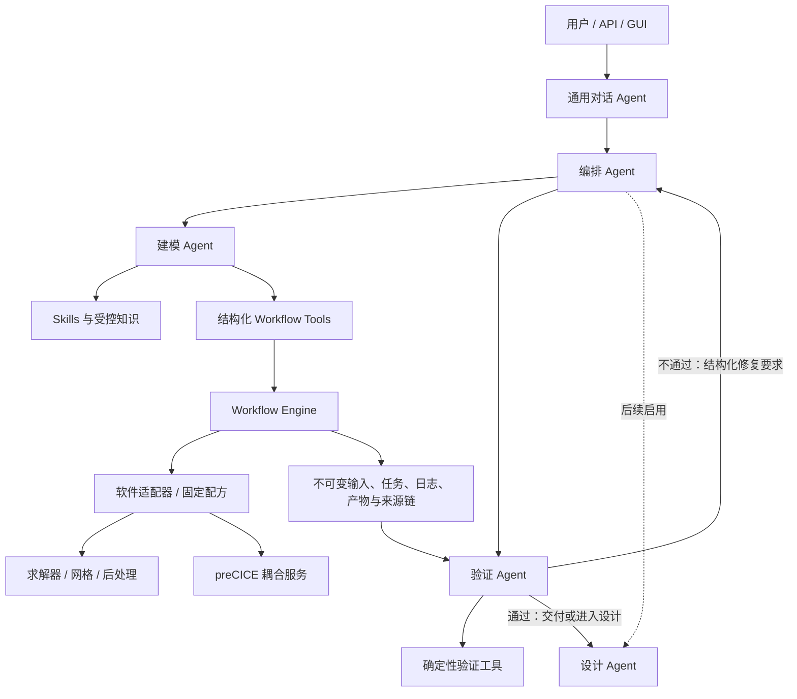

# Logos 增量开发计划

日期：2026-10-06  
状态：讨论稿，用于统一架构认知、确定增量顺序和设置验收门槛

## 1. 结论先行

Logos 不应继续被定义为“给 VibeFlow 再加几个 Agent”，而应被定义为一个分层的多物理场仿真智能体平台：

```text
多智能体负责理解、分工、判断和修订
结构化 Workflow 负责状态、执行、恢复、产物和证据
求解器及 preCICE 负责确定性的数值计算与耦合
Skills / RAG / Memory 负责向 Agent 提供不同生命周期的知识
```

VibeFlow 和 Gridy 的核心形态都可以概括为“通用 Tool-use Agent + Skills + 执行工具/外部软件”。多个求解器 Skill 不等于多个 Agent，支持多个软件也不等于已经实现跨求解器数值耦合。现有材料没有证明二者具备职责隔离、结构化交付和独立上下文组成的多智能体架构，也没有证明已经形成可复现的跨求解器耦合闭环。

历史 Logos 原型是在 VibeFlow 可观察合同的恢复基础上，保留 Agent Core，并增加结构化 CAE Workflow Engine。Agent 与 Workflow 通过 Host/Bridge 连接；Workflow 不是一个简单函数直接塞进 Agent，而是经由结构化请求进入 `ToolBridge -> WorkflowService -> JobSupervisor`。这一步实现的是执行能力、工程状态、产物和证据的结构化，不是多智能体，也不是数值耦合。

当前 `logos/` 已经比历史原型多走了一步：存在编排、建模、验证三个独立 Deep Agent 的骨架，以及外层 LangGraph、结构化 Pydantic 契约、隔离的线程 ID、冻结产物和哈希验证；设计 Agent 仍是占位。但它只执行 placeholder，没有接入真实求解器、历史 Workflow Engine、preCICE、持久化 Checkpointer、长期 Memory 或完整工程 Skills。因此，当前缺口应准确写为：

1. 多智能体只有可运行骨架，尚未成为真实工程闭环。
2. 结构化 Workflow 资产尚未接入当前 LangGraph 原型并重新验证可靠性。
3. 尚无真实单求解器 MVP，更没有跨求解器耦合 MVP。
4. Skills 尚未系统迁移、治理和评测。
5. RAG、长期 Memory、设计优化和更多软件接口均未达到应进入主路径的成熟度。

下一阶段应先把“多智能体骨架 + 结构化 Workflow + 一个真实 MVP”连成可信闭环，再进入 preCICE 耦合。不要先扩展大量软件，也不要先建设大而全的 RAG 和 Memory。

## 2. 基线架构认知

### 2.1 VibeFlow

VibeFlow 的基线架构是：

```text
用户
  -> 通用 Agent / Tool loop
  -> 按任务加载的领域 Skills
  -> 文件、Shell、Web、工程软件及后处理工具
  -> caseDict、阶段目录、日志和结果
```

其中：

- 通用 Agent 是自然语言入口和工具调用者。
- Skills 是求解器知识、操作流程、检查规则和经验，不是独立 Agent。
- 外部求解器、网格和后处理程序承担实际执行。
- `caseDict`、阶段目录和产物承担一部分工作流状态与工程上下文。
- 已观察到的规划、验证和回退中，有相当部分可能由 Prompt/Skill/Agent 介导，不能统一视为独立的确定性控制器。

因此，VibeFlow 可以有自己的简单 Agent 底座，也可以由外部通用 Agent 通过其工具和工程合同接入；但现有证据不支持把它描述为一个成熟多智能体系统。

### 2.2 Gridy

Gridy 与 VibeFlow 的总体范式相近：通用 Agent/Sidecar、工程 Skills、工具调用、软件连接和桌面交互。它具备子任务和通用 Agent 基础设施，但“可创建子任务”不等于已经形成固定的工程多智能体组织。

其多个软件 Skill 仍然主要是知识与操作能力，不是按编排、建模、验证、设计分工的独立 Agent。现有恢复材料也没有证明统一的跨求解器数据交换、时间推进、网格映射、检查点回滚和耦合收敛闭环。

Gridy 适合复用的主要是 Skills、工程软件操作经验、会话/工具基础设施和产品交互思路，而不是直接复制一个已验证的多智能体或耦合框架。

### 2.3 历史 Logos 原型

历史 Logos 不是取得 VibeFlow 原作者源码后直接修改，而是基于可授权访问材料，对其可观察合同进行恢复和兼容实现。应使用“合同恢复/逆向兼容基线”这一表述，避免声称恢复了不可证实的原生内部实现。

其主要变化是：

```text
VibeFlow 风格 Agent Core
  + 版本化 Host API
  + 结构化 CAE Workflow Engine
  + Desktop Host / Bridge
  + 任务、输入快照、产物、验证与证据
```

历史桥接链路为：

```text
Agent loop
  -> run_shell_command 中的 fvf JSON envelope
  -> BridgeExecutor
  -> ToolBridge.dispatch()
  -> WorkflowService
  -> JobSupervisor
  -> 外部工具/求解器
```

因此更准确的说法是：Workflow 当时没有作为一组原生、一级的 Agent Tools 直接注册，而是借用 Shell 工具入口，由 Host 截获结构化 envelope 后桥接到 Workflow。对 Agent 来说它表现为结构化工程能力，对实现来说仍存在一层兼容桥。

Workflow Engine 结构化了以下内容：

- 工程身份、revision、case 和输入快照；
- 配方、适配器、前置条件和资源预算；
- 队列、运行、取消、超时和进程状态；
- 日志、收据、产物哈希、来源和验证记录；
- 执行成功、文件验证、产物发布和工程验收等不同状态。

它没有解决的核心问题仍是多智能体与真实跨求解器数值耦合。

### 2.4 当前 Logos LangGraph 原型

当前 `logos/` 的实际状态如下：

| 能力 | 当前状态 | 判断 |
| --- | --- | --- |
| 编排 Agent | 已有独立 Deep Agent 和 `TaskPlan` | 骨架可用 |
| 建模 Agent | 已有独立 Deep Agent 和 `ModelingDeliverable` | 仅生成 placeholder 方案 |
| 验证 Agent | 独立上下文，读取冻结 manifest 并校验 Schema/哈希 | 只验证证据完整性，不做数值或工程验收 |
| 设计 Agent | 文件占位，默认关闭 | 未实现 |
| 外层编排 | LangGraph 状态机，支持有限修订循环 | 尚无持久化和真实作业恢复 |
| Agent 底座 | Deep Agents + LangChain | 已接入基础能力 |
| Workflow | 当前图内只有 placeholder 冻结执行 | 历史 Workflow Engine 尚未接回 |
| Skills | 仅有编排、建模、验证三份最小说明 | 领域能力尚未迁移 |
| 工具 | 环境探测、冻结产物验证 | 无真实求解器工具 |
| 耦合 | 只有结构字段和方案文本 | 无 preCICE 或其他耦合执行 |
| Memory | `InMemorySaver` | 重启即丢失，无长期记忆 |
| 测试 | 一个 live 三 Agent 流程与篡改检测、一个空输入测试 | 覆盖面不足，且依赖外部模型 |

所以，后续不是从零“增加多智能体”，而是把当前三 Agent 骨架固化为有明确状态所有权、结构化交付、可恢复执行和可衡量收益的工程系统。

## 3. 目标架构

### 3.1 顶层结构

首个可交付版本采用三个实际 Agent，设计 Agent 只保留接口：



### 3.2 四个 Agent 的边界

| Agent | 核心职责 | 不应承担的职责 |
| --- | --- | --- |
| 编排 Agent | 澄清目标、拆解任务、选择流程、分配 Agent、控制预算和停止条件 | 不直接拼求解器命令，不自行宣告工程通过 |
| 建模 Agent | 建立物理模型、边界条件、单位、求解和耦合方案；调用受控 Workflow Tools | 不直接修改共享执行账本，不以文本代替运行证据 |
| 验证 Agent | 在隔离上下文中读取冻结输入和原始证据；调用确定性检查并形成结论 | 不只复述建模 Agent 的总结，不修改模型或原始结果 |
| 设计 Agent | 未来生成/修改构型，定义设计变量、约束和优化策略 | 首个 MVP 不启用，不绕过建模和验证直接输出“最优”结果 |

借鉴 AIAero 时，只采用“总师/编排 + 专业建模 + 独立评审 + 生成式设计 + 人工监督”的角色组织思路。当前公开资料只有产品演示，存在定时步骤和硬编码结果卡片，未发现明确对应的开源仓库、API 或可复现实验。因此，不能把 AIAero 的底层多智能体框架视为已验证成熟组件，也没有可直接复用的代码依据。Logos 的实际多智能体运行框架仍以 LangGraph/LangChain/Deep Agents 为主。

### 3.3 框架分工

| 技术 | 在 Logos 中的职责 |
| --- | --- |
| Deep Agents | 提供通用 Agent 底座、工具调用、Skills 加载、上下文管理和可选子 Agent 能力 |
| LangChain | 提供模型适配、Tools、结构化输出和中间件接口 |
| LangGraph | 持有跨 Agent 的显式状态机、条件路由、重试、暂停/恢复、人工确认和持久化 Checkpoint |
| Logos Workflow Engine | 持有确定性的工程任务状态、幂等提交、进程生命周期、输入快照、产物和验证证据 |
| preCICE 或同类耦合器 | 持有跨求解器的数据交换、映射、时间窗、迭代和收敛机制 |

需要避免两个状态机争夺同一状态：LangGraph 是“推理与协作状态”的权威来源，Workflow Engine 是“工程执行状态”的权威来源。Agent 通过任务 ID 和产物引用读取 Workflow 状态，不复制或猜测它。

### 3.4 Tool 设计原则

所有会改变工程状态、启动计算或发布产物的操作，都必须通过带 Schema 的受控 Tool/Adapter 进入 Workflow；但不应把某个软件的每一个低层 API 都暴露成单独的 LLM Tool。

建议首批一级工具保持小而稳定：

- `workflow.inspect`
- `workflow.submit`
- `task.get`
- `task.cancel`
- `artifact.get`
- `artifact.list`
- `validation.run`
- `capability.inspect`

软件内部的几十或几百个动作由版本化 Adapter 和固定 Recipe 封装。读取、诊断类能力可按需开放；任意 Shell、GUI 自动化和动态脚本只作为受控兜底，并需要权限、预算和审计。这样既能工具化关键边界，又不会让模型直接编排脆弱的低层软件操作。

## 4. 可复用资产与采用条件

| 来源 | 候选复用内容 | 不能直接假设 | 采用动作 |
| --- | --- | --- | --- |
| 当前 `logos/` | 三 Agent、LangGraph 外图、结构化契约、隔离验证、哈希证据 | 已经完成真实工程多智能体 | 作为新主线骨架 |
| 历史 Logos | WorkflowService、JobSupervisor、Adapter/Recipe、Artifact Registry、验证和 Host 合同 | 可原样嵌入当前原型且仍可靠 | 先做合同测试，再选择移植、封装或重写 |
| VibeFlow Skills | OpenFOAM、SU2、MOOSE、网格、后处理、报告等领域流程 | Skill 内容都正确、兼容当前版本或许可可直接分发 | 建立来源、版本、许可证和评测清单后迁移 |
| Gridy Skills | COMSOL、Abaqus、工程检查和软件操作经验 | 商业软件在目标环境可用，或多软件即多物理耦合 | 仅迁移 MVP 需要的 Skill，实机验证 |
| AIAero | 角色划分、人类监督、设计—仿真—评审交互 | 底层框架、求解器连接和结果可复现 | 作为产品与组织参考，不作为代码依赖 |
| LangChain/LangGraph/Deep Agents | Agent 运行、Tool、结构化输出、图状态和 Checkpoint | 框架自动提供工程正确性 | 工程状态、验证器和证据仍由 Logos 实现 |
| preCICE | 分区耦合、数据映射、时间窗和隐式迭代 | 任意两个模型文件都能自动耦合 | 先核验参与求解器 Adapter、变量和回滚能力 |

Skills 迁移遵循“按需而不是全量”的原则。每个 Skill 至少记录来源、版本/提交、许可证、适用软件版本、依赖、允许的工具、验证算例、最后验证日期和已知失败模式。未通过验证的 Skill 只能标记为候选知识，不能进入自动执行主路径。

## 5. 增量开发阶段

阶段按依赖和验收门槛推进，不先承诺日历时间。每一阶段只有通过 Gate 才进入下一阶段。

### 阶段 0：冻结基线并确定 MVP

目标：消除版本与口径混乱，选定一个可复现的真实任务。

工作项：

1. 将历史 Logos、当前 `logos/` 和未来目标分别标记为 `legacy`、`prototype`、`target`，禁止混用“已实现”。
2. 固化当前 placeholder 流程为回归基线，补齐不依赖外部模型的单元测试。
3. 建立 MVP 选择表，但暂不预设具体软件：
   - `MVP_SOLVER = TBD`
   - `MVP_CASE = TBD`
   - `MVP_PHYSICS = TBD`
   - `MVP_ACCEPTANCE = TBD`
   - `MVP_DEPLOYMENT = local | remote (TBD)`
4. 从软件可获得性、许可证、脚本/API 稳定性、运行时间、标准答案、网格/残差/守恒可检查性和 CI 可运行性七项评分。
5. 明确人工确认点、最大重试次数、成本和运行时间预算。

Gate 0：在一台干净目标环境中，placeholder 基线测试稳定通过；MVP 软件、算例、输入、标准答案和验收规则有书面决定。

### 阶段 1：固化多智能体协作内核

目标：把现有三个 Agent 从演示骨架提升为稳定、可恢复、可评测的协作内核。

工作项：

1. 定稿 `TaskPlan`、`ModelingSpec`、`ExecutionRequest`、`ExecutionReceipt`、`ArtifactManifest`、`ValidationReport` 和 `DecisionRequest`。
2. 每次 Agent 交付只传结构化字段和产物引用；大型文件、场数据和完整日志不进入对话消息。
3. 将 Checkpointer 从 `InMemorySaver` 替换为持久化实现，支持进程重启后的图恢复。
4. 保持建模与验证上下文隔离；验证 Agent 只接收目标、验收条件和冻结证据引用。
5. 给重试、修订、人工确认、取消和预算耗尽建立显式边。
6. 设计 Agent 继续关闭，只完成契约和图中的保留节点。
7. 用同一任务对比单 Agent 与三 Agent：成功率、修复次数、Token/时间成本和错误发现率。多 Agent 没有净收益的步骤不拆 Agent。

Gate 1：图可从任一持久化节点恢复；重复事件不会重复提交执行；上下文隔离测试、结构化输出失败测试、预算终止测试和人工确认测试全部通过。

### 阶段 2：验证并接回结构化 Workflow

目标：用真实合同测试决定历史 Workflow Engine 哪些部分可复用，并将其作为一级结构化 Tools 接入当前 Agent 图。

工作项：

1. 在当前 Agent 与 Workflow 之间定义稳定 Port，避免当前代码直接依赖历史桌面层。
2. 优先把历史 `fvf JSON over shell` 桥改造成原生 Tool 调用；兼容桥可保留，但不作为新主路径。
3. 对候选 Workflow 资产执行可靠性测试：
   - 同一幂等键重复提交；
   - 进程异常退出和服务重启；
   - 取消、超时和子进程清理；
   - 输入 revision 或 hash 已过期；
   - 缺失、陈旧、篡改或部分生成的输出；
   - 并发任务和资源预算；
   - 任务成功但数值检查失败；
   - 日志、收据、产物和来源链是否完整。
4. 按测试结果对每个模块做 `adopt / refactor / replace` 决策，不整体搬运旧工程。
5. 确保 LangGraph 只保存 Workflow task ID、阶段结论和引用，运行细节由 Workflow Engine 持久化。

Gate 2：Workflow 服务在 Agent 缺席时也能独立通过合同测试；Agent 只能通过受控 Tool 改变工程状态；崩溃恢复后不会重复运行或错误复用旧产物。

### 阶段 3：打通一个真实单求解器 MVP

目标：替换 placeholder，完成第一个可复现的“建模—执行—验证—修订”闭环。

工作项：

1. 只实现 `MVP_SOLVER` 所需的一个 Adapter 和少量固定 Recipe。
2. 增加版本探针、环境检查、输入生成、启动、流式日志、取消、结果采集和错误分类。
3. 将相关 VibeFlow/Gridy Skills 迁移为最小集合，并绑定具体软件版本和算例。
4. 验证至少覆盖 Schema、单位、边界条件、网格质量、求解残差/收敛、守恒或其他物理量、结果字段和产物完整性。
5. 明确区分：
   - `execution_status`
   - `numerical_validation_status`
   - `engineering_status`
6. 构建 10—20 个固定任务的回归集，包含正常、缺参、错误边界、坏网格、求解失败、陈旧输出和篡改产物。

Gate 3：固定任务可在相同环境重复得到一致的关键指标和证据；任何 Agent 文本都不能把“退出码为零”升级为“数值验证或工程验收通过”。

### 阶段 4：实现第一个多物理场耦合切片

目标：通过 preCICE 或评估后选定的同类方案，实现两个参与者之间的真实数值耦合。

阶段开始前再确定：

- `COUPLING_CASE = TBD`
- `PARTICIPANT_A = TBD`
- `PARTICIPANT_B = TBD`
- `EXCHANGE_FIELDS = TBD`
- `COUPLING_SCHEME = explicit | implicit (TBD)`

工作项：

1. 比较 preCICE 与候选同类方案的求解器适配器、平台支持、许可证、数据映射、并行、检查点和调试能力；preCICE 是默认候选，不是未经验证的既定依赖。
2. 将耦合配置建模为结构化合同：参与者、接口、网格、交换量、单位、坐标系、方向、映射、时间窗、收敛准则和最大迭代。
3. 由建模 Agent 制定耦合方案，Workflow 启停参与者并保存状态，耦合器处理逐步数据交换；禁止 Agent 消息逐时间步传场数据。
4. 对隐式耦合核验每个参与者的 checkpoint/rollback 能力。
5. 记录每个时间窗和耦合迭代的残差、失败原因、重启点及输入/输出版本。
6. 先对官方或标准教程做数值复现，再进入自定义工程案例。

Gate 4：标准耦合算例可重复运行；能检测变量/单位/方向/网格映射错误；中断可从受支持的检查点恢复；结果与基准容差一致。

### 阶段 5：启用设计 Agent 与有限优化

目标：在已有可信仿真闭环上增加构型生成和有限范围优化，而不是让设计 Agent 直接生成未经验证的最终答案。

工作项：

1. 定义设计变量、离散/连续范围、约束、目标、预算和停止条件。
2. 设计 Agent 只产生候选构型/参数集；每个候选必须进入建模、执行和验证闭环。
3. 参数扫描和优化算法由确定性工具执行，Agent 负责选择策略、解释结果和发起下一轮。
4. 保存所有候选、失败点、约束违反、代理模型版本和高保真复核结果。
5. 人工监督模式作为默认模式；全自动模式只在限定问题和明确预算内开放。

Gate 5：优化结果可从完整候选历史重放；违反约束的候选不会进入“可接受设计”；所谓“最优”始终绑定搜索空间、预算和验证证据。

### 阶段 6：按评测引入 RAG 与长期 Memory

目标：只在 Skills 和显式项目状态不足时引入额外知识系统。

知识层分工如下：

| 层 | 适合保存的内容 | 首版策略 |
| --- | --- | --- |
| LangGraph State/Checkpoint | 当前任务、节点、决策、待办和恢复位置 | 阶段 1 必须实现 |
| Artifact/Workflow Store | 输入、任务、日志、结果、版本和证据 | 阶段 2 必须实现 |
| Skills | 稳定、可审查的操作流程与领域规则 | MVP 按需迁移 |
| Project Memory | 经确认的项目事实、偏好、历史决策 | 后置，结构化并可人工编辑 |
| RAG | 大量手册、历史报告和参考资料的检索 | 后置，以检索评测决定是否上线 |
| Episodic Memory | 过去运行的经验和修复模式 | 后置，只从已验证运行提炼 |

RAG 进入主路径前必须有检索评测集，衡量命中率、引用正确性、版本匹配和对任务成功率的净提升。长期 Memory 不能自动把 Agent 推断写成项目事实；写入需包含来源、时间、作用域、置信度和确认状态，并支持过期与删除。

Gate 6：在固定任务集上，RAG/Memory 相比 Skills-only 基线带来可测的成功率或人工时间改善，且不会提高错误版本引用和陈旧事实污染率。

## 6. 建议的代码增量边界

在当前 `logos/src/agent/` 基础上，优先形成以下责任边界；具体文件名可在实施时调整：

```text
agent/
  agents/          # orchestration / modeling / validation / design
  contracts/       # 跨 Agent、Workflow 和证据的版本化 Schema
  graphs/          # 顶层图与子图，不保存求解器内部状态
  skills/          # 经过治理的领域 Skills
  tools/           # 小型、稳定的一级 Agent Tools
  workflow_ports/  # Workflow 客户端和接口，不依赖桌面 GUI
  storage/         # Checkpointer、Store 和项目记忆接口

workflow/
  service/         # 请求、状态、幂等和恢复
  runtime/         # 作业、取消、预算、日志和进程树
  adapters/        # 软件/求解器适配器
  recipes/         # 固定、版本化执行配方
  artifacts/       # 快照、manifest、hash、provenance
  validation/      # 确定性数值与文件检查
  coupling/        # preCICE 或其他耦合后端

evals/
  tasks/           # 固定任务集
  fixtures/        # 正常与故障夹具
  baselines/       # 单 Agent、Skills-only 等对照
  reports/         # 成功率、成本、修复和验收指标
```

不建议把整个历史 `workflow-engine/` 直接复制到当前原型，也不建议让新的 Agent 图反向依赖 Qt 桌面代码。先建立 Port 和合同测试，再逐模块复用。

## 7. 验收指标

每个版本至少报告以下指标，且区分系统完成与工程正确：

| 指标 | 含义 |
| --- | --- |
| 任务完成率 | 在预算内完成规定流程的比例 |
| 首轮成功率 | 无修订完成的比例 |
| 数值验证通过率 | 通过确定性数值检查的比例 |
| 工程验收率 | 通过定义好的工程标准或人工验收的比例 |
| 错误分类准确率 | 对缺参、环境、输入、求解、耦合和结果错误的分类能力 |
| 修复有效率 | 修订后真正消除原问题且未引入回归的比例 |
| 证据完整率 | 输入、版本、日志、收据、产物和检查结果齐全的比例 |
| 可重复率 | 相同冻结输入和环境下关键结果落入容差的比例 |
| 恢复成功率 | 重启/中断后正确恢复且不重复执行的比例 |
| 人工介入时间 | 完成任务所需人工处理时间 |
| Agent 成本 | Token、模型调用次数和推理耗时 |

多智能体必须与单 Agent 基线做同任务、同模型、同预算比较。只有当独立验证、上下文隔离或职责分工带来可测收益时，才继续增加 Agent；不得按软件数量或物理场数量机械增加 Agent。

## 8. 主要风险与控制

| 风险 | 控制措施 |
| --- | --- |
| 多 Agent 增加沟通成本但不提高成功率 | 保留单 Agent 对照，按评测决定是否拆分 |
| LangGraph 与 Workflow 重复持有执行状态 | 明确状态所有权，仅通过 ID 和事件同步 |
| 旧 Workflow 代码复杂且与桌面耦合 | Port 隔离，逐模块合同测试后复用 |
| Skill 内容陈旧、冲突或许可不清 | 来源账本、版本绑定、许可证检查和执行评测 |
| LLM 直接拼命令导致不可审计执行 | 固定 Recipe、Schema Tool、白名单参数和审批 |
| 把文件完整性误当物理正确性 | 分离执行、文件、数值和工程验收状态 |
| 耦合器接入后仍缺求解器回滚能力 | 在方案选择阶段验证 Adapter 和 checkpoint/rollback |
| RAG/Memory 引入旧版本或错误事实 | 后置上线、引用来源、过期策略和评测门禁 |
| 过早接入大量商业软件 | MVP 只选一个后端，后续按真实需求扩展 |

## 9. 当前应立即执行的事项

1. 完成阶段 0：确定真实 MVP 软件、算例、运行环境和验收标准。
2. 将当前三 Agent placeholder 测试扩成确定性回归集，并加入持久化/恢复设计。
3. 从历史 Workflow Engine 抽取最小稳定 Port 和合同测试，不先搬桌面 UI。
4. 建立 Skills 来源与验证清单，只选择 MVP 必需的 VibeFlow/Gridy Skills。
5. 在单求解器闭环通过前，不启动大规模 RAG、长期 Memory、设计优化或多软件接入。
6. 单求解器 Gate 通过后，再冻结第一个 preCICE/同类耦合算例和参与者组合。

## 10. 依据与证据边界

本计划基于以下工作区材料整理：

- 当前原型：`README.md`、`src/agent/graph.py`、`src/agent/contracts.py`、`src/agent/agents/`、`tests/test_live_workflow.py`
- 历史 Logos 架构：`../Logos-main-extracted/Logos-main/docs/architecture.md`
- VibeFlow 恢复材料：`../vibeflow-recover/win64-3bfeb9ca/source/`
- Gridy 分析：`../gridy-recover/analysis/gridy-agent-deep-analysis.md`
- 多物理场 Agent 调研：`../research/REPORT.md`
- 已确认的新架构讨论：`新架构.md`

关于 AIAero、Gridy 和 VibeFlow 的产品能力，只采用当前材料能够支持的证据等级。产品展示、Skill 数量、软件列表、前端流程或 Agent 文本均不自动等同于真实求解、数值耦合、工程验证或生产成熟度。
