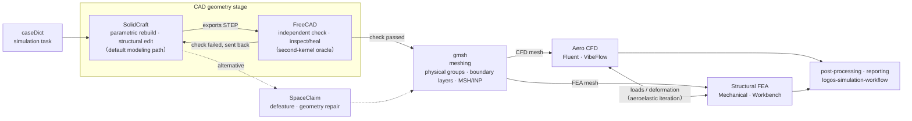

# LOGOS — Aircraft Design & Simulation Agent

[中文（主版本）](README.md) · **English**

> Current server version: **[v0.2.0](https://github.com/Chiang030/logos-modified/releases/tag/v0.2.0)** · VS Code extension: **v0.1.7** (not yet tracking v0.2.0)

LOGOS turns a large language model into **an engineer that can actually do the work**: you give tasks in natural language inside a project directory, and it autonomously handles parametric CAD modeling with independent verification, finite-element meshing, aerodynamic CFD and structural FEA solving, high-frequency EM simulation, ECAD (PCB) analysis, and 3D rendering — delivering results backed by verifiable evidence (test output, exported files, screenshots).

The platform drives conversation and task execution on an open-source coding-agent kernel; external engineering software attaches through the **MCP protocol**; per-domain operating knowledge is captured as **skills** — each skill owns task routing, records locally verified environment facts, and defines acceptance criteria; solver invocations follow a controlled discover → select → execute-session chain; the geometry stage enforces **separation of producer and checker**, reviewed independently by a second kernel; and the multi-stage simulation flow (geometry → mesh → solve → post-process → report) carries explicit stage handoffs and acceptance discipline.

> **Repository note**: this repository (`logos-modified`) is the code actually running on the server — the product layer (`logos-agent/`, built on the vendored [Pi runtime](https://github.com/earendil-works/pi) at `vendor/pi/`), self-maintained tool integrations (`integrations/`), built-in skills (`pi-domain/skills/`) and deployment scripts; see [Repository layout](#repository-layout) for details.

---

## Contents

- [Usage](#usage)
- [Repository layout](#repository-layout)
- [Integrated software](#integrated-software)
- [Tool surface](#tool-surface)
- [MCP services](#mcp-services)
- [Built-in skills](#built-in-skills)
- [Implemented features](#implemented-features)
- [Basic workflow](#basic-workflow)
- [Install and deployment](#install-and-deployment)
- [Verification status](#verification-status)

---

## Usage

### Option 1 (recommended): VS Code Remote-SSH + terminal CLI

1. Install the **Remote-SSH** extension in VS Code and connect to the server (e.g. `ssh jiangjincheng@172.19.103.12`);
2. Open the target project folder and a new integrated terminal;
3. Type **`logos-here`** to wake LOGOS: it creates a dedicated tmux session for the current directory and starts LOGOS — the paper-plane + LOGOS wordmark animation confirms it is up. Re-running it in the same project re-attaches to the existing session;
4. All conversation and task execution happen in that terminal, with the full v0.2.0 capability set.


### Option 2: VS Code extension (v0.1.7)

The LOGOS VS Code extension provides a graphical panel: server connection status, session management, and an agent registry (invoke agents in chat with `@agent-name`, e.g. `@logos` the main agent, `@kicad`, `@freecad`, `@ansys`).


Quick start (from the [plugin manual PPT](docs/manual/LOGOS仿真助手智能体插件手册.pptx), in Chinese):

1. **Install**: "Install from VSIX" in VS Code and pick the extension package; installation takes a few minutes, after which the LOGOS icon appears in the sidebar — click it to enter the agent;
2. **First-time API setup**: open the gear settings panel, enter the URL and API key → "fetch upstream models" → pick a model → save and apply, then return to chat;
3. **New session**: click "new session" in the history panel on the right;
4. **Ansys invocation guidance**: for visual interactive work use the **"gRPC server"** mode (the agent drives the GUI directly; multiple instances may conflict); for batch solving use the **"MAPDL"** mode (headless APDL script batches; no GUI, weaker observability). Just tell the agent which one to use.

> **Note**: the extension is currently at **v0.1.7** and lags the server's v0.2.0 (recent skills and integrations are not included); prefer Option 1. The extension has only been lightly tested; most known issues are permission-related — please report bugs.

---

## Repository layout

```
logos-server/
├── bin/logos                # entry script (keeps caller cwd, discovers project AGENTS.md)
├── start.sh / install.sh    # deployment entry / optional one-shot dependency setup
├── logos-agent/             # LOGOS product layer (CLI + prompts + skills + integrations over Pi)
│   ├── bin/logos.mjs        # the real launcher: preloads Pi source resolver, injects layered prompts
│   ├── pi-domain/
│   │   ├── prompts/         # system.md (base role) + append.md (global add-on rules)
│   │   ├── skills/          # 12 built-in skills (see below)
│   │   ├── extensions/      # custom tool registration, e.g. simulation.mjs
│   │   └── src/ui/logo.mjs  # terminal ASCII animation (paper plane + star orbit + LOGOS wordmark)
│   ├── integrations/
│   │   ├── sim-cli/         # simulation CLI core (v0.3.9, LOGOS-maintained fork)
│   │   ├── plugins/         # Mechanical / Workbench plugins (0.1.6+logos.1 / 0.1.2+logos.1)
│   │   ├── kicad-mcp-server/# KiCad MCP server source fork (patch list in NOTICE)
│   │   ├── blender-mcp/     # blender MCP launcher + registration script
│   │   └── setup.py         # one-shot .venv creation and installs
│   ├── docs/                # builtin-skills.md / simulation-tool.md / wordmark-design.md
│   └── deploy/              # launcher copies for distribution packaging
├── docs/                    # ops notes, e.g. ansys-261-connection-issues.md
└── vendor/pi/               # Pi source submodule (official v1.1.0 baseline)
```

## Integrated software

All verified live on the server (dates under [Verification status](#verification-status)):

| Domain | Software | Access path |
|---|---|---|
| CFD | Ansys Fluent | sim sessions / PyFluent scripts / file-side review; VibeFlow batch flows |
| Structural FEA | Ansys Mechanical | sim-cli + PyMechanical (live sessions), DPF (offline .rst) |
| Multiphysics projects | Ansys Workbench | sim-cli journal-driven + persistent sessions |
| High-frequency EM | Ansys HFSS | PyAEDT / AEDT (no 3D Layout, Maxwell, etc. yet) |
| Geometry preprocessing | Ansys SpaceClaim / Discovery | scripting + GUI-attached operation |
| Parametric CAD | SolidCraft | `solidcraft` MCP (parametric rebuild, assembly, measurement, screenshots) |
| CAD cross-checking | FreeCAD 1.1.4 | `freecad` skill (headless `freecadcmd`): inspect/heal/convert/symmetric-diff; the independent oracle at the geometry stage exit, **not the default geometry source** (workflow-enforced) |
| Meshing | Gmsh | CLI / Python API (STEP/BREP import, physical groups, boundary layers, MSH/INP export) |
| ECAD | KiCad 10.0.7 (system) + 9.0.9 (user-space alternative) | `kicad` MCP fork + kicad-cli |
| 3D authoring & rendering | Blender 5.2.2 LTS | `blender` MCP (resident GUI instance under xvfb, addon on 127.0.0.1:9876) |
| Batch CFD | VibeFlow / VibeCAE | caseDict → .cas.h5/.dat.h5, journals, parallel, UDFs |

Base runtime: Node.js ≥ 22.19 (Pi sources), Python 3.11 (integration .venv), DeepSeek API (key in `logos-agent/.env`).

## Tool surface

Tools available to the agent fall into four groups; MCP tools all use `exposure: deferred` and are discovered on demand via the kernel's `tool_search`, never preloaded in bulk. 🆕 = added 2026-10-21.

**1. Kernel built-ins (general)**

| Tool | Purpose |
|---|---|
| `bash` | Command execution: shell, scripts, any CLI (skill scripts run through it too) |
| `read` / `write` / `edit` | File read, write, precise edits |

**2. LOGOS built-in extensions** (`pi-domain/extensions/`)

| Tool | Purpose |
|---|---|
| `simulation_discover` | Discover Mechanical / Workbench installations on the target host, returning evidence and selectable install IDs |
| `simulation` | `launch` / `probe` / `attach` on a chosen install ID, driving solver sessions |

**3. MCP services** (namespace `mcp__<server>__<tool>`)

| Service | Tools | Capabilities |
|---|---|---|
| `solidcraft` | 9 | `inspect_design`, `list_commands`, `execute`, `batch`, `measure`, `screenshot`, `open`, `save`, `export` |
| `kicad` 🆕 | 47 | Schematic reading and editing (components/nets/symbol search, part placement), PCB analysis (statistics, pours, power/signal integrity), layout and track tracing, netlist generation and connectivity, parts-registry search, pin-function analysis, device-tree and firmware test-code generation, hierarchical net analysis, ERC/DRC validation and reports, Gerber/SVG/STEP export |
| `blender` 🆕 | 9 | `execute_blender_code` (run Python inside Blender), `get_scene_info`, `look` (screenshot review), `get_addon_status`, `search_assets` / `import_asset` (Poly Haven / Sketchfab libraries), `generate_3d` (text/image to model), and more |

**4. Skill scripts** (invoked via `bash`, not part of the tool-call surface)

| Skill | Scripts | Purpose |
|---|---|---|
| `freecad` 🆕 | `inspect_cad.py` / `compare_step.py` / `heal_convert.py` | CAD inspection, independent symmetric-diff verification, healing and format conversion (headless `freecadcmd`) |
| `solidcraft` | `step_preflight.py` | STEP import preflight |

## MCP services

MCP servers are registered in `~/.pi/agent/mcp.json` (outside the repo; written by each integration's `register-mcp.py`, merged never replaced, backed up first). The three registered services all use `exposure: deferred` + a Chinese description (doubles as skill-routing hints):

| Service | Launcher | timeout | Capabilities |
|---|---|---|---|
| `solidcraft` | `~/.local/bin/solidcraft-cli mcp --allow-path ~/projects` | 1800s | Parametric CAD modeling, configuration rebuild, geometry editing, mechanism assembly, measurement, screenshot export |
| `kicad` | `integrations/kicad-mcp-server/bin/kicad-mcp-server` | 300s | Schematic/PCB analysis, ERC/DRC, netlist tracing, Gerber/SVG/STEP export, parts search, firmware pin/device-tree generation (47 tools) |
| `blender` | `integrations/blender-mcp/bin/blender-mcp-server` | 300s | Text/SVG logos into 3D, metallic materials, PNG renders, turntable MP4, GLB export |

Key points:

- **The kicad MCP is a LOGOS-maintained fork** (based on Seeed Studio 0.1.0, patches in `integrations/kicad-mcp-server/NOTICE`). Do not point the agent at a separately pip-installed copy — two editable installs of the same package shadow each other; that is how the "ERC always passes" bug survived. The launcher probes interpreters in the order `$LOGOS_KICAD_PYTHON` → `integrations/.venv` → `~/.local/opt/kicad-mcp-venv` → `PATH`.
- **The blender MCP needs a resident GUI instance**: the addon cannot run `--background`, so the systemd --user unit `blender-mcp.service` hosts it under `xvfb-run` with linger enabled. The launcher pins the uvx path + Tsinghua PyPI mirror (astral.sh is proxy-blocked).
- After moving this tree, re-run `python3 register-mcp.py` in each integration directory and restart the LOGOS session.

## Built-in skills

Skills live at `pi-domain/skills/<name>/SKILL.md` (Claude-style frontmatter; body carries scope routing, locally verified facts tables, verification commands). The launcher registers them all via `--skill`; **new sessions pick changes up with no build step**; `--no-skills` disables them. Deep references sit in each skill's `references/`.

| Skill | Purpose |
|---|---|
| `logos-simulation-workflow` | Master caseDict/simulation flow: geometry → mesh → solve → post-process → report stage handoffs |
| `sim-cli` | Cross-solver discipline: install selection, runtime evidence, session ownership, input requirements, acceptance and failure handling |
| `fluent-sim` | Fluent's three control paths: live sim sessions / direct PyFluent / file-side review |
| `mechanical-sim` | Mechanical (live PyMechanical sessions) and DPF (offline .rst results) |
| `workbench-sim` | Workbench projects, journals, persistent sessions, handoff to Mechanical |
| `hfss` | HFSS 3D: PyAEDT / AEDT / sim-plugin-hfss / native workflows |
| `spaceclaim` | SpaceClaim / Discovery geometry inspect/repair/defeature/scripting (only when explicitly requested) |
| `solidcraft` | Default CAD rebuild path: drawings/dimensions/reference models/STEP → parametric parts and assemblies |
| `gmsh` | FE meshing: import, repair, physical groups, size fields, boundary layers, quality checks, multi-format export |
| `kicad` | Full KiCad project flow (see MCP table), facts table distinguishing system 10.0.7 from user-space 9.0.9 |
| `blender` | 3D logos / brand renders: extrude+bevel, PBR metals, transparent/dark PNGs, turntable MP4, GLB |
| `vibeflow-fluent` | caseDict → Fluent commercial CFD batch: headless runs, journals, residual monitoring, checkpoints |
| `freecad` | Independent CAD verification and file-level ops: second-kernel cross-check, dirty-file inspect/heal, format conversion (not a modeling path) |

The Ansys skills are verbatim copies from the user-supplied `reusable-assets/harnesses/ansys-agent-harness/skills`; provenance in `skills/import-manifest.json`.

## Implemented features

- **LOGOS CLI** (`bin/logos` → `logos-agent/bin/logos.mjs`): keeps caller cwd, discovers project `AGENTS.md`; terminal welcome animation (paper plane + star orbit + image-derived LOGOS wordmark, auto-degrading on narrow terminals), `/logos` replays it, `LOGOS_WORDMARK` / `LOGOS_NO_ANIMATION` / `LOGOS_ASCII` tune it; interactive / print / JSON / RPC modes (RPC lets VS Code-class clients reuse the same entry).
- **Layered system prompts**: `pi-domain/prompts/system.md` (base role, injected via `--system-prompt`) + `append.md` (global add-on rules) + skills + `references/toolchain.md` (instance toolchain snapshot, not auto-injected); restart to apply.
- **Simulation integration** (`integrations/`): sim-cli core + two LOGOS-maintained Mechanical/Workbench plugins, isolated in `.venv`; the `simulation_discover` / `simulation` tools close the "discover → pick ID → probe → session execution" loop; remote machines need the same modified sources deployed.
- **KiCad integration**: MCP fork (47 tools, 29 offline regression + 14 stdio smoke checks), dual-version toolchain facts table in the skill.
- **Blender/3D integration**: MCP + resident GUI instance covering the 3D-logo pipeline (see `references/demo_logo.py`).
- **SolidCraft CAD integration**: MCP wrapper around the external CLI, `--allow-path` scopes accessible project dirs. The workflow mandates SolidCraft as the default geometry path — never CadQuery/FreeCAD; FreeCAD (`freecadcmd`) is wired through the `freecad` skill (no MCP, direct scripts) as the independent cross-check oracle, foreign-file healer and format converter.
- **API configuration**: the launcher auto-reads `logos-agent/.env` (cwd-independent); `DEEPSEEK_API_KEY` + `LOGOS_PROVIDER` / `LOGOS_MODEL`, CLI flags win.

## Basic workflow

### Geometry → aero/structure pipeline

The engineering trunk: SolidCraft models and structurally modifies, FreeCAD independently verifies with a second kernel, gmsh splits CFD/FEA meshes, and the two branches iterate on loads/deformation (aeroelasticity):



The `.solidcraft` design is the editable source, staged exports as STEP artifacts; FreeCAD verification (inspection, symmetric-difference comparison) failing sends geometry back — passing releases it to gmsh. The producing tool never grades its own work. SpaceClaim is the optional solver-facing preprocessing path. `logos-simulation-workflow` + `sim-cli` own stage handoffs and acceptance throughout.

**Daily use (one session per project):**

```bash
cd /path/to/your/project        # LOGOS takes this as workspace, discovers its AGENTS.md
logos-here                      # recommended: one-command dedicated tmux session per dir
~/.local/bin/logos              # or invoke the entry script directly
```

The server convention is one tmux session per project running `bin/logos`, so projects never collide; `logos-here` is the one-command wrapper around that convention. Once a task arrives:

1. **Routing**: Pi routes by each skill's frontmatter description (kicad tasks → `kicad`, 3D logos → `blender`, simulations → `logos-simulation-workflow` + `sim-cli`, …);
2. **Evidence first**: skill bodies/`references/` carry locally verified facts tables (which binary, which version) — verify before acting;
3. **Execution**: MCP tools (`mcp__kicad__*` / `mcp__blender__*` / `mcp__solidcraft__*`), `simulation_discover`+`simulation` (solvers), `bash`/`edit` (general) combine as needed;
4. **Acceptance**: evidence per the skill's acceptance rules (test scripts, exported files, screenshots); failure paths are specified too.

**The recipe for adding a new tool (kicad / blender precedents):**

1. Register the MCP server into `~/.pi/agent/mcp.json` (merge, never replace; fields command / timeout / `exposure:"deferred"` / a Chinese description carrying routing hints); launcher under `logos-agent/integrations/<name>/bin/` with a `register-mcp.py` (backups / `--dry-run` / `--remove`);
2. Skill at `logos-agent/pi-domain/skills/<name>/SKILL.md` (frontmatter + scope routing + dated environment facts table + verification commands), deep material in `references/`;
3. Restart the session; no build step.

**Touching the Pi kernel**: commit inside `vendor/pi/` first (it has its own Git history, from official v1.1.0), then record the new submodule commit in this repo; to share, push the Pi branch to your fork and update the submodule URL.

## Install and deployment

See [start.sh / install.sh](install.sh). Essentials:

```bash
# deps already in place, from any project dir:
bash /path/to/logos-server/start.sh

# fresh server, one-time prep:
npm --prefix logos-agent run pi:setup          # Node deps + model catalog
python3 logos-agent/integrations/setup.py      # simulation/KiCad .venv (optional)
cp logos-agent/.env.example logos-agent/.env   # fill in DEEPSEEK_API_KEY etc.
# optional: install.sh --with-sim --shortcut creates ~/.local/bin/logos
```

On Windows, unzip then run `pi:setup` + `setup.py` + `.env`, launch with `logos.cmd`. Installation does not imply licensed solver availability; the capability matrix starts empty and is proven by on-server tests. Network-restricted environments: when astral.sh is proxy-blocked, pip-install `uv` from the Tsinghua mirror and set `UV_DEFAULT_INDEX=https://pypi.tuna.tsinghua.edu.cn/simple`.

## Verification status

| Item | Status | Date |
|---|---|---|
| Linux deployment + Pi-source launch | ✅ verified on server | since 2026-10-09 |
| sim integration (57 Python tests + 8 Node tests, doctor reports both plugins healthy) | ✅ (no licensed solver launched) | at packaging |
| KiCad 10.0.7 system stack + 9.0.9 user-space stack, MCP fork 47 tools | ✅ verified on server | 2026-10-21 |
| Blender 5.2.2 LTS + systemd xvfb resident instance + MCP tool names live-tested | ✅ verified on server | 2026-10-21 |
| FreeCAD 1.1.4 skill, 10-case regression | ✅ verified on server | 2026-10-21 |
| HFSS / Fluent / Mechanical / Workbench live solves | ⚠️ skills and chain ready; licensing and GUI attachment need on-site verification | — |

License: root `LICENSE`; Pi upstream and per-integration upstream licenses under `vendor/pi/` and each integration directory.
