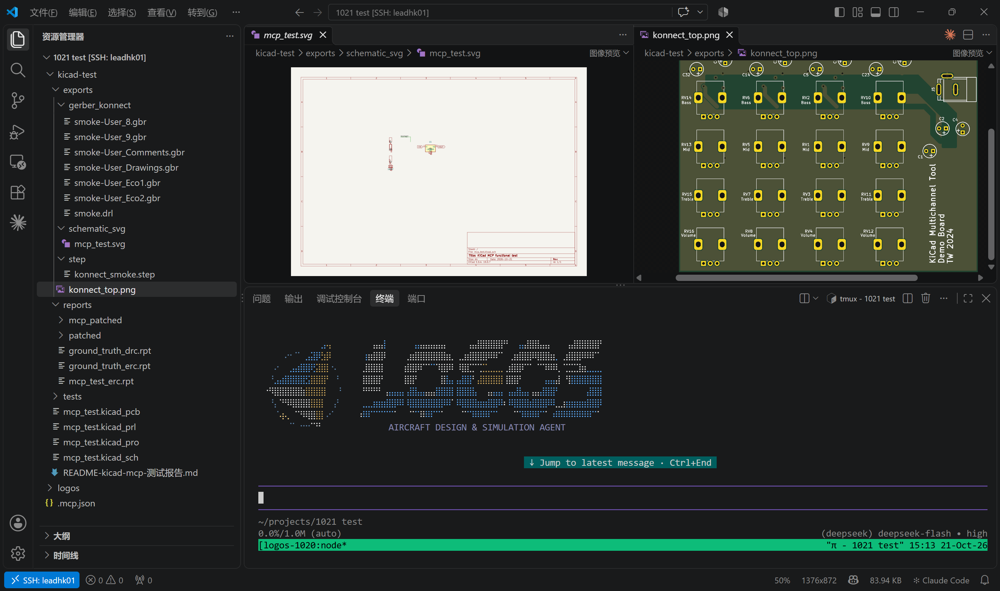
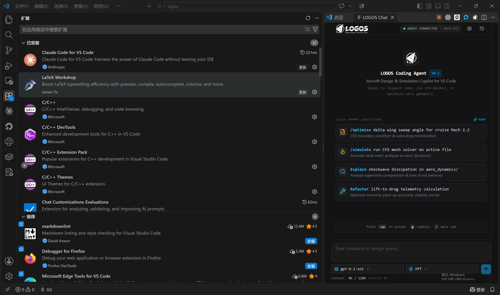
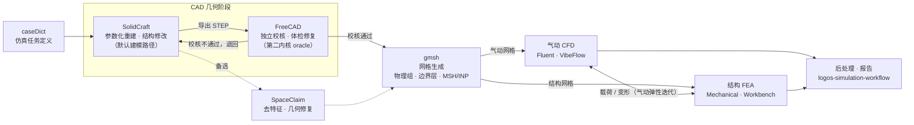

# LOGOS — 飞行器设计与仿真智能体

**[中文(主版本)](README.md)** · [English](README.en.md)

> 当前服务端版本:**[v0.2.0](https://github.com/Chiang030/logos-modified/releases/tag/v0.2.0)** · VS Code 插件:**v0.2.0**(已跟进 v0.2.0,支持插件内自检更新)

LOGOS 是把大语言模型变成**能动手的工程师**的智能体平台:你在项目目录里用自然语言下达任务,它自主完成 CAD 参数化建模与独立校核、有限元网格划分、气动 CFD 与结构 FEA 求解、高频电磁仿真、电路板(ECAD)分析、3D 渲染制作等工程任务,并以可验证的证据(测试结果、导出文件、截图)交付。

平台用开源 coding-agent 内核驱动对话与任务执行,外部工程软件经 **MCP 协议**接入,各领域操作知识沉淀为**技能**——技能负责任务路由、记录本机环境事实、定义验收标准;求解器调用遵循"探测安装 → 选型 → 会话执行"的受控链路;几何阶段强制**生产与校核分离**,由第二内核独立复核;多阶段仿真流程(几何 → 网格 → 求解 → 后处理 → 报告)设有明确的阶段交接与验收纪律。

> **仓库备注**:本仓库(`logos-modified`)是平台在服务器上实际运行的那份代码——产品层(`logos-agent/`,构建于 vendored 的 [Pi runtime](https://github.com/earendil-works/pi) `vendor/pi/` 之上)、自维护的工具集成(`integrations/`)、内置技能(`pi-domain/skills/`)与部署脚本,目录细节见[仓库结构](#仓库结构)。

---

## 目录

- [使用方式](#使用方式)
- [仓库结构](#仓库结构)
- [已接入的软件](#已接入的软件)
- [工具面总览](#工具面总览)
- [MCP 服务](#mcp-服务)
- [内置 Skills](#内置-skills)
- [已实现的功能](#已实现的功能)
- [基本工作流程](#基本工作流程)
- [安装与部署](#安装与部署)
- [验证状态](#验证状态)

---

## 使用方式

### 方式一(推荐):VS Code Remote-SSH + 终端 CLI

1. 在 VS Code 安装 **Remote-SSH** 扩展,连接服务器(例 `ssh jiangjincheng@172.19.103.12`);
2. 打开目标项目文件夹,开一个集成终端;
3. 输入 **`logos-here`** 唤醒:它按当前目录建一个专属 tmux 会话并启动 LOGOS,纸飞机 + LOGOS 字标动画出现即成功;同一项目再次调用会自动接回原会话;
4. 之后的对话与任务执行都在该终端里进行,支持全部 v0.2.0 能力。



### 方式二:VS Code 插件(v0.2.0)

LOGOS VS Code 扩展提供图形化面板:服务器连接状态、会话管理、Agent 注册表(聊天中用 `@智能体名` 唤起,如 `@logos` 主智能体、`@kicad`、`@freecad`、`@ansys`)。



上手四步(摘自[《LOGOS 仿真助手智能体插件手册》](docs/manual/LOGOS仿真助手智能体插件手册.pptx)):

1. **安装**:VS Code 里"从 VSIX 安装",选中插件安装包;安装需几分钟,完成后侧边栏出现 LOGOS 图标,点开即进入智能体;
2. **首次配置 API**:点齿轮进入设置面板,填入 URL 与 API key → "获取上游模型" → 选择模型 → 保存并应用,返回聊天;
3. **开新会话**:右侧历史记录里点 new session;
4. **Ansys 调用建议**:需要可视化交互时用 **"gRPC 服务器"** 方式(智能体直接控制 GUI,缺点是多开可能冲突);需要批量求解时用 **"MAPDL"** 方式(APDL 脚本无头批量,缺点是无 GUI、可观测性差);直接告诉智能体用哪种即可。

> **注意**:v0.1.7 及更早版本体内没有更新器,请手工安装一次 v0.2.0;此后插件会启动时静默检查更新(24 小时至多一次),也可随时运行 **LOGOS: Check for Updates** 手动检查、一键升级(私有更新源需 GitHub 授权,详见插件 README)。插件仅经过少量测试,遇到的问题以权限类居多,发现 bug 请反馈。

---

## 仓库结构

```
logos-server/
├── bin/logos                # 入口脚本(保留调用者工作目录,发现项目 AGENTS.md)
├── start.sh / install.sh    # 部署入口 / 可选的一键依赖准备
├── logos-agent/             # LOGOS 产品层(Pi 之上的 CLI + 提示词 + 技能 + 集成)
│   ├── bin/logos.mjs        # 真正的启动器:预加载 Pi 源码解析器,注入分层提示词
│   ├── pi-domain/
│   │   ├── prompts/         # system.md(基础角色)+ append.md(全局追加规则)
│   │   ├── skills/          # 12 个内置 Skill(见下文)
│   │   ├── extensions/      # simulation.mjs 等自定义工具注册
│   │   └── src/ui/logo.mjs  # 终端 ASCII 动画(纸飞机 + 星点轨道 + LOGOS 字标)
│   ├── integrations/
│   │   ├── sim-cli/         # 仿真 CLI 核心(v0.3.9,LOGOS 维护 fork)
│   │   ├── plugins/         # Mechanical / Workbench 插件(0.1.6+logos.1 / 0.1.2+logos.1)
│   │   ├── kicad-mcp-server/# KiCad MCP 服务源码 fork(见 NOTICE 的补丁清单)
│   │   ├── blender-mcp/     # blender MCP 启动器 + 注册脚本
│   │   └── setup.py         # 一键创建 .venv 并安装上述组件
│   ├── docs/                # builtin-skills.md / simulation-tool.md / wordmark-design.md
│   └── deploy/              # 分发打包用的启动脚本副本
├── docs/                    # ansys-261-connection-issues.md 等运维记录
└── vendor/pi/               # Pi 源码 submodule(官方 v1.1.0 起点)
```

## 已接入的软件

以下软件均已在服务器上实测可用(验证日期见 [验证状态](#验证状态)):

| 领域 | 软件 | 接入方式 |
|---|---|---|
| CFD | Ansys Fluent | sim 会话 / PyFluent 脚本 / 文件侧审查;VibeFlow 批处理流程 |
| 结构 FEA | Ansys Mechanical | sim-cli + PyMechanical(实时会话), DPF(离线 .rst) |
| 多物理项目 | Ansys Workbench | sim-cli journal 驱动 + 持久会话 |
| 高频电磁 | Ansys HFSS | PyAEDT / AEDT(不含 3D Layout、Maxwell 等) |
| 几何前处理 | Ansys SpaceClaim / Discovery | 脚本 + GUI 附件化操作 |
| CAD 参数化建模 | SolidCraft | `solidcraft` MCP(参数化重建、装配、测量、截图) |
| CAD 交叉验证 | FreeCAD 1.1.4 | `freecad` 技能(`freecadcmd` headless):体检/修复/格式转换/对称差对比,几何阶段出口的独立复核 oracle,**非默认几何源**(工作流明文规定) |
| 网格生成 | Gmsh | CLI / Python API(STEP/BREP 导入、物理组、边界层、MSH/INP 导出) |
| ECAD | KiCad 10.0.7(系统)+ 9.0.9(用户态备选) | `kicad` MCP fork + kicad-cli |
| 3D 制作渲染 | Blender 5.2.2 LTS | `blender` MCP(xvfb 常驻 GUI 实例,插件监听 127.0.0.1:9876) |
| 批处理 CFD | VibeFlow / VibeCAE | caseDict → .cas.h5/.dat.h5、journal、并行、UDF |

底座运行时:Node.js ≥ 22.19(Pi 源码)、Python 3.11(集成 .venv)、DeepSeek API(`logos-agent/.env` 配 Key)。

## 工具面总览

智能体可调用的工具按来源分四类;MCP 工具均为 `exposure: deferred`,由内核的 `tool_search` 按需发现,不整批预载。🆕 = 2026-10-21 新增。

**一、内核内置(通用)**

| 工具 | 用途 |
|---|---|
| `bash` | 命令执行:shell、脚本、各类 CLI(技能脚本也经它调用) |
| `read` / `write` / `edit` | 文件读取、写入、精确编辑 |

**二、LOGOS 内置扩展**(`pi-domain/extensions/`)

| 工具 | 用途 |
|---|---|
| `simulation_discover` | 探测目标主机的 Mechanical / Workbench 安装,返回证据与可选安装 ID |
| `simulation` | 对选定安装 ID 执行 `launch` / `probe` / `attach`,驱动求解会话 |

**三、MCP 服务**(命名空间 `mcp__<服务>__<工具>`)

| 服务 | 工具数 | 能力 |
|---|---|---|
| `solidcraft` | 9 | `inspect_design`、`list_commands`、`execute`、`batch`、`measure`、`screenshot`、`open`、`save`、`export` |
| `kicad` 🆕 | 47 | 原理图读取与编辑(组件/网络/符号检索、放置元件)、PCB 分析(统计、覆铜、电源/信号完整性)、布局与走线追踪、网表生成与连通性、元件库检索、引脚功能分析、设备树与固件测试代码生成、层级网络分析、ERC/DRC 校验与报告、Gerber/SVG/STEP 导出 |
| `blender` 🆕 | 9 | `execute_blender_code`(Blender 内执行 Python)、`get_scene_info`、`look`(截图查看)、`get_addon_status`、`search_assets` / `import_asset`(Poly Haven / Sketchfab 素材库)、`generate_3d`(文本/图片生成模型)等 |

**四、技能脚本**(经 `bash` 调用,不占工具调用面)

| 技能 | 脚本 | 用途 |
|---|---|---|
| `freecad` 🆕 | `inspect_cad.py` / `compare_step.py` / `heal_convert.py` | CAD 体检、对称差独立复核、修复与格式转换(headless `freecadcmd`) |
| `solidcraft` | `step_preflight.py` | STEP 导入预检 |

## MCP 服务

MCP 服务统一注册在 `~/.pi/agent/mcp.json`(不在仓库内,由各集成的 `register-mcp.py` 写入;merge 不替换、先备份)。当前注册的三个服务均为 `exposure: deferred` + 中文 description(兼作技能路由提示):

| 服务 | 启动器 | timeout | 能力 |
|---|---|---|---|
| `solidcraft` | `~/.local/bin/solidcraft-cli mcp --allow-path ~/projects` | 1800s | CAD 参数化建模、构型重建、几何编辑、机构装配、测量检查、截图导出 |
| `kicad` | `integrations/kicad-mcp-server/bin/kicad-mcp-server` | 300s | 原理图/PCB 分析、ERC/DRC、网表追踪、Gerber/SVG/STEP 导出、元件库检索、固件 pin/设备树生成(47 个工具) |
| `blender` | `integrations/blender-mcp/bin/blender-mcp-server` | 300s | 文字/SVG logo 立体化、金属材质、PNG 渲染、转圈 MP4、GLB 导出 |

要点:

- **kicad MCP 是 LOGOS 自维护 fork**(基于 Seeed Studio 0.1.0,补丁见 `integrations/kicad-mcp-server/NOTICE`)。不要把 agent 指向 pip 另装的副本——两个 editable install 会互相遮蔽,历史上的 "ERC always passes" bug 就是这么漏掉的。启动器按 `$LOGOS_KICAD_PYTHON` → `integrations/.venv` → `~/.local/opt/kicad-mcp-venv` → `PATH` 顺序探测解释器。
- **blender MCP 依赖常驻 GUI 实例**:插件不能在 `--background` 下跑,由 systemd --user 单元 `blender-mcp.service` 用 `xvfb-run` 承载,linger 已开。启动器固定 uvx 路径 + 清华 PyPI 镜像(astral.sh 被代理挡)。
- 移动本仓库目录后,在各集成目录重跑 `python3 register-mcp.py` 并重启 LOGOS 会话即可。

## 内置 Skills

Skill 放在 `pi-domain/skills/<name>/SKILL.md`(Claude 式 frontmatter,正文含 Scope 路由、本机验证事实表、验证命令),由启动器通过 `--skill` 统一注册,**新会话直接生效,无需构建**;`--no-skills` 可关闭。运行时按需读取,配套深资料在同目录 `references/`。

| Skill | 用途 |
|---|---|
| `logos-simulation-workflow` | caseDict 与仿真开发/执行的总流程:几何 → 网格 → 求解 → 后处理 → 报告的阶段交接 |
| `sim-cli` | 跨求解器纪律:安装选择、运行时证据、会话所有权、输入要求、验收与失败处理 |
| `fluent-sim` | Fluent 三条控制路径:live sim 会话 / PyFluent 直连 / 文件侧审查 |
| `mechanical-sim` | Mechanical(PyMechanical 实时会话)与 DPF(离线 .rst 结果) |
| `workbench-sim` | Workbench 项目、journal、持久会话与向 Mechanical 的交接 |
| `hfss` | HFSS 3D:PyAEDT / AEDT / sim-plugin-hfss / 原生工作流 |
| `spaceclaim` | SpaceClaim / Discovery 几何检查、修复、去特征、脚本化(仅用户明确指定时) |
| `solidcraft` | CAD 构型重建的默认路径:图纸/尺寸/参考模型/STEP → 参数化三维零件与装配 |
| `gmsh` | 有限元网格:导入、修复、物理组、尺寸场、边界层、质量检查、多格式导出 |
| `kicad` | KiCad 项目全流程(见上表 MCP 能力),环境事实表区分系统 10.0.7 与用户态 9.0.9 |
| `blender` | 3D logo / 品牌渲染:挤出倒角、PBR 金属材质、透明底/深色底 PNG、转圈 MP4、GLB |
| `vibeflow-fluent` | caseDict → Fluent 商用 CFD 批处理:headless 执行、journal、残差监控、断点 |
| `freecad` | CAD 独立复核与文件级操作:第二内核交叉验证、脏文件体检修复、格式转换(非建模路径) |

Ansys 系 Skill 完整复制自用户指定的 `reusable-assets/harnesses/ansys-agent-harness/skills`,来源见 `skills/import-manifest.json`。

## 已实现的功能

- **LOGOS CLI**(`bin/logos` → `logos-agent/bin/logos.mjs`):保留调用者工作目录、发现项目 `AGENTS.md`;终端欢迎动画(纸飞机 + 星点轨道 + 图片转换的 LOGOS 字标,窄终端自动降级),`/logos` 重播,`LOGOS_WORDMARK` / `LOGOS_NO_ANIMATION` / `LOGOS_ASCII` 可调;支持交互 / print / JSON / RPC 四种模式(RPC 供 VS Code 等客户端复用同一入口)。
- **分层系统提示词**:`pi-domain/prompts/system.md`(基础角色,经 `--system-prompt` 注入)+ `append.md`(全局追加规则)+ Skills + `references/toolchain.md`(实例工具链快照,不自动注入);改完重启生效。
- **仿真集成**(`integrations/`):sim-cli 核心 + Mechanical/Workbench 两个 LOGOS 维护插件,隔离在 `.venv`;`simulation_discover` / `simulation` 内置工具打通"探测 → 选 ID → probe → 会话执行"链路;远端机器需部署同源修改版。
- **KiCad 集成**:MCP fork(47 工具,29 项离线回归 + 14 项 stdio 冒烟测试),技能内维护双版本工具链事实表。
- **Blender/3D 集成**:MCP + 常驻 GUI 实例,覆盖 3D logo 全流程(含 `references/demo_logo.py` 演示脚本)。
- **SolidCraft CAD 集成**:外部 CLI 的 MCP 包装,`--allow-path` 限定可访问项目目录。工作流规定几何默认走 SolidCraft,不以 CadQuery/FreeCAD 为默认几何源;FreeCAD(`freecadcmd`)以 `freecad` 技能接入(无 MCP,脚本直调),用作独立 CAD 内核的交叉验证 oracle、外来文件修复与格式转换。
- **API 配置**:启动器自动读取 `logos-agent/.env`(不依赖 cwd),`DEEPSEEK_API_KEY` + `LOGOS_PROVIDER` / `LOGOS_MODEL`,命令行参数优先。

## 基本工作流程

### 几何 → 气动/结构管线

工程主干:SolidCraft 负责建模与结构修改,FreeCAD 以第二内核独立校核,gmsh 划分气动/结构网格,分别进入 CFD 与 FEA,两条支线可按载荷/变形迭代(气动弹性):



SolidCraft 的 `.solidcraft` 设计是可编辑源,按阶段导出 STEP 等产物;FreeCAD 校核(体检、对称差对比)不通过就退回修改,通过才放行给 gmsh——生产工具不给自己发合格证。SpaceClaim 是面向求解器的几何前处理备选路径。全程由 `logos-simulation-workflow` + `sim-cli` 管理阶段交接与验收。

**日常使用(按项目开会话):**

```bash
cd /path/to/your/project        # LOGOS 以此为工作区,发现该项目的 AGENTS.md
logos-here                      # 推荐:按当前目录一键建/接回专属 tmux 会话
~/.local/bin/logos              # 或直接跑入口脚本
```

服务器上的惯例是每个项目开一个 tmux 会话跑 `bin/logos`,互不干扰;`logos-here` 就是这个惯例的一键包装。任务进来后:

1. **路由**:Pi 按 Skill 的 frontmatter description 把任务路由到对应技能(kicad 任务 → `kicad` skill,3D logo → `blender` skill,仿真 → `logos-simulation-workflow` + `sim-cli`……);
2. **取证据**:技能正文/`references/` 里有本机验证过的事实表(哪个二进制、哪个版本),先核实再动手;
3. **执行**:MCP 工具(`mcp__kicad__*` / `mcp__blender__*` / `mcp__solidcraft__*`)、`simulation_discover`+`simulation`(求解器)、`bash`/`edit`(通用)按需组合;
4. **验收**:按技能里的验收规则输出证据(测试脚本、导出文件、截图),失败路径也有明确处理。

**给 LOGOS 加新工具的家法(以 kicad / blender 为先例):**

1. MCP 服务注册进 `~/.pi/agent/mcp.json`(merge 不替换;字段 command / timeout / `exposure:"deferred"` / description 用中文并带技能路由提示);启动器放 `logos-agent/integrations/<name>/bin/`,配 `register-mcp.py`(带备份 / `--dry-run` / `--remove`);
2. 技能放 `logos-agent/pi-domain/skills/<name>/SKILL.md`(frontmatter + Scope 路由 + 带验证日期的环境事实表 + 验证命令),深资料放 `references/`;
3. 重启会话即生效,无需构建。

**改 Pi 内核**:先在 `vendor/pi/` 提交(它有自己的 Git 历史,来自官方 v1.1.0),再由根仓库记录新的 submodule 提交;要共享需推到自己的 fork 并更新子模块地址。

## 安装与部署

详见 [start.sh / install.sh](install.sh)。要点:

```bash
# 依赖已就绪时,任意项目目录直接:
bash /path/to/logos-server/start.sh

# 全新服务器,一次性准备:
npm --prefix logos-agent run pi:setup          # Node 依赖 + 模型目录
python3 logos-agent/integrations/setup.py      # 仿真/KiCad 集成 .venv(可选)
cp logos-agent/.env.example logos-agent/.env   # 填 DEEPSEEK_API_KEY 等
# 可选:install.sh --with-sim --shortcut 在 ~/.local/bin 建 logos 快捷方式
```

Windows 解压后同样跑 `pi:setup` + `setup.py` + `.env`,用 `logos.cmd` 启动。安装不等于已授权求解器可用;能力矩阵从零开始,以服务器实测为准。网络受限环境:astral.sh 被代理挡时 `uv` 用 pip + 清华镜像装,PyPI 走 `UV_DEFAULT_INDEX=https://pypi.tuna.tsinghua.edu.cn/simple`。

## 验证状态

| 项目 | 状态 | 日期 |
|---|---|---|
| Linux 部署 + Pi 源码启动 | ✅ 服务器实测 | 2026-10-09 起 |
| sim 集成(57 项 Python 测试 + 8 项 Node 测试,doctor 双插件健康) | ✅(未启动授权求解器) | 打包时 |
| KiCad 10.0.7 系统栈 + 9.0.9 用户态栈、MCP fork 47 工具 | ✅ 服务器实测 | 2026-10-21 |
| Blender 5.2.2 LTS + systemd xvfb 常驻实例 + MCP 工具名实测 | ✅ 服务器实测 | 2026-10-21 |
| FreeCAD 1.1.4 技能三脚本,10 项回归 | ✅ 服务器实测 | 2026-10-21 |
| HFSS / Fluent / Mechanical / Workbench 实机求解 | ⚠️ 技能与链路就绪,许可与 GUI 附件化需服务器现场验证 | — |

许可证:根目录 `LICENSE`;Pi 上游与各集成上游的许可证在 `vendor/pi/` 与各集成目录内。
