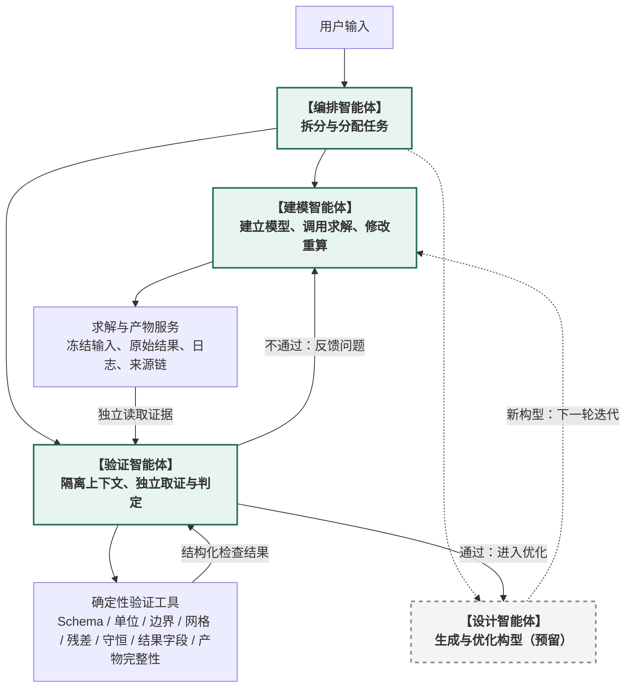

# 新架构设计

日期：2026-10-05  
最近更新：2026-10-06

依据：`presentation/simulation-agent-architecture.tex` 与本轮架构讨论。

## 1. 已确认的简化架构

采用一个编排智能体、一个建模智能体和一个验证智能体。验证智能体从首版开始独立部署，并与建模智能体保持上下文隔离；设计智能体当前仅占位。确定性验证服务是验证智能体调用的工具，不替代验证智能体。



图中实线表示当前建模与验证闭环，设计相关虚线表示未来能力。图展示业务流程；具体任务派发与决策由编排智能体统筹。

## 2. 智能体职责与数量控制

| 智能体 | 职责 | 当前状态 |
| --- | --- | --- |
| 编排智能体 | 根据用户输入澄清目标、拆分和分配任务，统筹修改与优化循环 | 纳入实现范围 |
| 建模智能体 | 建立物理模型与耦合方案，生成配置，调用求解，获取运行状态与产物，修改并重新计算 | 纳入实现范围 |
| 验证智能体 | 在隔离上下文中独立读取冻结输入、原始结果、日志、验证规则和来源链；调用确定性验证工具并形成结论、问题与证据 | 纳入实现范围 |
| 设计智能体 | 直接生成新构型；根据原构型的仿真评价自动迭代构型 | 仅保留位置，暂不展开实现 |

严格控制智能体数量，只有需要独立推理与明确交付的职责才设为智能体。当前建模与耦合方案由同一智能体负责，不按软件名称另设智能体。

计算归建模智能体负责调用，实际执行由确定性工具层完成。求解器、preCICE、任务管理和 ParaView 不增加智能体数量。

### 2.1 按物理场划分领域子智能体的扩展建议

保留按物理场拆分的能力，但当前不为每个物理场设置常驻子智能体。先让建模智能体承担整体建模与耦合职责，通过领域 Skills 支持不同物理场；当某个领域需要独立规划、推理与修复时，再按需启用领域子智能体。

拆分依据是独立建模决策的复杂度，而不是物理场或求解器数量。该建议属于预留扩展，不改变第 1 节已经确认的顶层架构。

| 场景 | 建议组织方式 |
| --- | --- |
| 单一求解器内部的热—结构耦合，方案成熟 | 一个建模智能体配合领域 Skills |
| 流体与结构使用不同求解器，分别需要复杂建模和排错 | 可按需启用流体、结构领域子智能体 |
| 多物理场问题中某一领域特别复杂 | 仅拆出该领域 |
| 参数扫描、重复运行、常规后处理 | 使用工具与作业调度，不增加智能体 |

候选职责层级如下，领域子智能体均为按需扩展：

```text
编排智能体
    ├─ 建模智能体：负责完整模型与耦合方案
    │     ├─ 流体领域子智能体：按需启用
    │     └─ 结构领域子智能体：按需启用
    ├─ 验证智能体
    └─ 设计智能体：预留
```

领域子智能体向建模智能体交付，由建模智能体整合并检查跨领域一致性。领域子智能体不能各自修改共享耦合配置；完整模型与耦合方案由建模智能体统一负责，整体任务与决策仍由编排智能体统筹。

拆分能够隔离专业知识和上下文，也会增加协作成本与假设冲突风险。例如，各领域对接口坐标、压力方向、时间步或位移参考状态的理解可能不一致。因此，领域交付至少需要包含：

- 本领域模型、材料与边界条件。
- 接口位置、交换量、单位、坐标系与方向约定。
- 时间推进要求，以及检查点与回滚能力。
- 模型假设、有效范围与本领域验证证据。
- 输入版本、产物引用和未解决问题，沿用第 5 节的公共交付契约。

是否启用领域子智能体，应使用同一耦合算例比较交付质量、修复有效性与通信成本。支持多个物理场不意味着自动启动多个智能体，首版优先使用 Skills，领域委派的启用规则和数量上限仍待验证。

## 3. 建模、计算、验证与设计闭环

### 3.1 建模与验证的职责边界

建模与验证必须由两个独立智能体承担，并保持上下文隔离。隔离的目的，是让验证智能体从原始证据重新建立判断，避免继承建模假设或复述建模智能体的总结。

当前建议采用：

```text
编排智能体
    ├─ 建模智能体：建模、配置、调用求解、根据验证问题修改模型
    └─ 验证智能体：隔离上下文、独立取证、综合判定与结构化反馈
           └─ 确定性验证工具：Schema、单位、边界、网格、残差、守恒、结果字段、产物完整性
```

其中：

- 建模智能体不能自行将任务标记为“工程验收通过”。
- 验证智能体从首版开始启用，并拥有与建模智能体隔离的会话、工作记忆和任务上下文。
- 单位、边界条件、网格质量、残差、守恒误差、结果字段和文件完整性由确定性验证工具检查；验证智能体负责选择检查、综合证据、核对建模意图、审查物理假设并处理冲突。
- 验证智能体必须直接读取冻结的输入版本、原始结果、求解日志、验证规则和产物来源，不能只接收或复述建模智能体的总结。
- 验证结论通过结构化契约返回建模智能体，包含检查项、阈值、观测值、证据引用、失败原因和修复要求。

因此，首版实际部署采用“编排智能体 + 建模智能体 + 验证智能体”，确定性验证服务位于验证智能体的工具层。上下文隔离会增加一次独立取证与推理成本，但这是验证独立性的必要条件。

1. 编排智能体根据用户输入分配任务。
2. 建模智能体建立模型，调用求解或耦合计算。
3. 系统冻结本次输入、原始结果、日志、验证规则和来源链；验证智能体在隔离上下文中独立读取这些证据并调用确定性验证工具。
4. 不通过时，验证智能体通过结构化契约反馈问题给建模智能体；修改后生成新的输入版本，重新计算并再次验证。
5. 通过时，未来交给设计智能体进行优化迭代；新构型再进入建模、计算与验证流程。

当前讨论中的“能过”表示计算完成且通过当前检查。执行成功、数值验证通过与工程目标满足需要分别记录；计算能运行不等于物理结果正确，也不等于构型最优。具体检查规则仍需结合目标算例确定。

设计智能体尚未实现时，验证通过的结果作为当前闭环交付，不实际触发设计迭代。

## 4. 多物理场耦合与 preCICE

目标是超越分别调用单个仿真软件，支持求解器之间真实的多物理场耦合。当前采用直接接入 preCICE 的方向，暂不讨论用多智能体重新实现其数值耦合方法。

- 建模智能体定义耦合方案，包括参与求解器、接口、交换物理量、单位、空间映射、时间配置及收敛要求。
- 工程工具服务与任务管理服务校验配置、管理作业和资源、启动或取消计算。
- 求解器适配器通过 preCICE API 交换数据；preCICE 执行时间窗协调、空间映射、隐式迭代等数值机制。
- 智能体读取运行状态和结果，必要时修订方案，不通过智能体消息逐时间步转发场数据。

preCICE 不是传入两个模型文件即可自动完成耦合的通用工具。目标求解器需要可用适配器；隐式耦合还可能要求检查点与状态回滚能力，需实际核验。

## 5. 结构化任务与交付

高度结构化是核心要求。智能体之间的任务和交付应有可校验的数据契约，下游执行读取结构化字段，自然语言用于解释。

建议契约包含以下信息，具体 schema 尚未定稿：

| 类别 | 建议内容 |
| --- | --- |
| 身份与来源 | 任务 ID、上游任务、输入版本 |
| 任务定义 | 目标、约束、允许修改的范围 |
| 工程定义 | 物理假设、单位、坐标系、边界与耦合接口引用 |
| 执行状态 | 等待、运行、完成、失败、取消或需要补充输入 |
| 交付结果 | 产物引用、验证结果、未解决问题 |
| 证据 | 日志、指标、文件哈希或来源记录 |
| 决策请求 | 缺失信息、需要上层决定的选项及影响 |

大型网格、场数据和原生模型保存在产物层，通过引用交付，不放入对话消息。模型修改与新一轮计算必须关联新的输入版本，避免混用结果。

## 6. LangGraph 子图、后台任务与外部接入

当前进程内的编排、建模和验证优先组合为 LangGraph 可静态发现的子图，不把完整工作流隐藏在普通 Tool 的同步 `invoke()` 内。这样可以继承父图的 Checkpointer，使用稳定的子图 namespace，并通过 `stream.subgraphs` 观察消息、状态与工具事件。

真正需要独立 Thread、后台运行和中途追加指令的 Agent 长任务，优先采用 Deep Agents Async Subagents 与 Agent Server 已有接口：

- `start_async_task`：启动任务并返回任务 ID。
- `check_async_task`：查询状态和结果。
- `cancel_async_task`：取消任务。
- `update_async_task`：追加信息或修改要求。
- `list_async_tasks`：列出当前任务。

A2A 保留为跨框架或跨服务互操作选项。进程内协作和同一 LangGraph Server 中的 Agent 不重复设计一套提交、查询、取消和恢复协议。真实求解器的作业管理仍由工程任务服务负责，不能用 Agent 任务状态替代 HPC 或求解器调度状态。

继续采用编排智能体统筹的星形协作，避免子智能体相互调用形成无约束循环。关键决策点使用 LangGraph `interrupt()` 与 `Command(resume=...)`，持久化由父图 Checkpointer 和 Store 统一提供。

## 7. 前端与 ParaView

前端需要承载对话、项目与构型、模型输入版本、任务进度、耦合状态、验证报告和结果查看。

用户认可 VibeFlow 的 ParaView 集成体验，希望借鉴。候选方向是前端围绕项目和运行组织，ParaView 承担专业后处理与结果视图；查看结果时关联本次输入版本、验证指标与证据。

具体集成方式尚未确定：外部 ParaView、嵌入或深度控制、以及基于 ParaView 服务的 Web 展示均需结合本地或远程部署需求评估。VibeFlow 的实际集成机制需查看代码核验。

## 8. 后续需要验证的事项

- 选择首个目标算例，明确求解器、交换物理量和成功标准。
- 核验 preCICE 适配器与求解器的接口、检查点和回滚能力。
- 用完整任务测试结构化契约，包括派发、交付、校验、执行及失败修复。
- 验证验证智能体是否独立读取输入与结果，并通过确定性工具形成证据。
- 用同一耦合算例比较单一建模智能体配合 Skills 与按需领域子智能体的效果，确定拆分条件和数量上限。
- 明确物理假设变更、计算预算、重试与停止条件的决策规则。
- 核验 ParaView 集成、数据规模、部署与打包路径。

本文件保存讨论确认的简化架构与重要设计思路；候选接口、实现技术和验收规则不视为已经验证或定稿。
